# Halcyon Ferris — Gallium, tap layers

Personal ZMK config for a splitkb **Halcyon Ferris** (34 keys) with a **Halcyon dongle**,
two **encoder modules** and **coincell batteries**. Built from the
[splitkb Halcyon config template](https://github.com/splitkb/zmk-halcyon-config) — see its
README for build-target and module documentation ([porting guide](PORTING.md)).

Linux only. Intended to eventually replace a Planck.

> **Status:** flashed and working on all three devices (dongle + both halves); in daily
> tuning — see [TODO](#todo).

## Hardware / build

| Target | Board | Shields | Notes |
| --- | --- | --- | --- |
| Dongle (central) | `halcyon_dongle//zmk` | `halcyon_ferris_dongle` | pointing enabled |
| Left half | `halcyon_wireless//zmk` | `halcyon_ferris_left mod_battery_coincell mod_encoder_left` | peripheral (`CONFIG_ZMK_SPLIT_ROLE_CENTRAL=n`) |
| Right half | `halcyon_wireless//zmk` | `halcyon_ferris_right mod_battery_coincell mod_encoder_right` | peripheral |

The dongle is the split central: it owns the keymap, combos and the USB connection, which
saves the halves' coincells. `CONFIG_ZMK_POINTING=y` (mouse keys, scroll) is only set on the
dongle because only the central sends HID reports.

Key positions: `0–9` top row, `10–19` home, `20–29` bottom, thumbs `30 31 | 32 33`
(left outer, left inner, right inner, right outer), `34–43` Halcyon module row
(`34` = left knob press, `43` = right knob press).

## Host setup

- XKB layout **`us(altgr-intl)`** (KDE: `kxkbrc` + Fcitx 5 profile `keyboard-us-altgr-intl`).
  The keymap sends `AltGr+key` for ä å ö € — Right Alt is reserved for AltGr, so the right-hand
  Alt combo sends *Left* Alt.
- Fcitx 5 with pinyin as a second input method.

## Layers

All layer switching is by **tap** (`&to`): a layer stays until you leave it. No holds.



<details>
<summary>Text version</summary>

```
BASE  (Gallium, column-staggered)
┌─────┬─────┬─────┬─────┬─────┐   ┌─────┬─────┬─────┬─────┬─────┐
│  B  │  L  │  D  │  C  │  V  │   │  J  │  Y  │  O  │  U  │  ,  │
│ Tab │  _  │  /  │  -  │  (  │   │  )  │  ä  │  å  │  ö  │     │  upper pairs: characters
│  N  │  R  │  T  │  S  │  G  │   │  P  │  H  │  A  │  E  │  I  │
│     │ gui │ alt │ ctl │     │   │     │ ctl │ alt │ gui │     │  lower pairs: sticky mods
│  X  │  Q  │  M  │  W  │  Z  │   │  K  │  F  │  '  │  ;  │  .  │
└─────┴─────┴─────┼─────┼─────┤   ├─────┼─────┼─────┴─────┴─────┘
                  │ ⇧1× │ Spc │   │ Ent │  ⌫  │   ⇧1× = sticky shift, double-tap = caps word
                  └──┬──┴──┬──┘   └──┬──┴──┬──┘
                     └─NUM─┘         └─SYM─┘      thumb pairs → layer (all layers)
                           └── Esc ──┘            Spc+Ent (not on NUM)
                  └──────── NAV ────────┘        both outer thumbs (all layers)

SYM  (Pascal Getreuer's symbol layer, ? and _ in place of , and .)
┌─────┬─────┬─────┬─────┬─────┐   ┌─────┬─────┬─────┬─────┬─────┐
│  `  │  <  │  >  │  -  │  |  │   │  ^  │  {  │  }  │  $  │  \  │
├─────┼─────┼─────┼─────┼─────┤   ├─────┼─────┼─────┼─────┼─────┤
│  !  │  *  │  /  │  =  │  &  │   │  #  │  (  │  )  │  ;  │  "  │
├─────┼─────┼─────┼─────┼─────┤   ├─────┼─────┼─────┼─────┼─────┤
│  ~  │  +  │  [  │  ]  │  %  │   │  @  │  :  │  ?  │  _  │  '  │
└─────┴─────┴─────┼─────┼─────┤   ├─────┼─────┼─────┴─────┴─────┘
                  │→BASE│Spc→B│   │Ent→B│  ⌫  │   Spc→B / Ent→B = key, then back to BASE

NAV
┌─────┬─────┬─────┬─────┬─────┐   ┌─────┬─────┬─────┬─────┬─────┐
│Undo │ Cut │Copy │Paste│Redo │   │ ⇧←  │ ⇧↓  │ ⇧↑  │ ⇧→  │     │  select
├─────┼─────┼─────┼─────┼─────┤   ├─────┼─────┼─────┼─────┼─────┤
│ Esc │ Tab │ ⇧Tab│ Del │ ⌃F  │   │  ←  │  ↓  │  ↑  │  →  │Mouse│  move
├─────┼─────┼─────┼─────┼─────┤   ├─────┼─────┼─────┼─────┼─────┤
│     │PrtSc│PrvTb│NxtTb│ ⌃A  │   │Home │PgDn │PgUp │ End │     │  jump
└─────┴─────┴─────┼─────┼─────┤   ├─────┼─────┼─────┴─────┴─────┘
                  │→BASE│ Spc │   │ Ent │  ⌫  │

NUM
┌─────┬─────┬─────┬─────┬─────┐   ┌─────┬─────┬─────┬─────┬─────┐
│     │ F7  │ F8  │ F9  │ F10 │   │  +  │  7  │  8  │  9  │  ,  │
├─────┼─────┼─────┼─────┼─────┤   ├─────┼─────┼─────┼─────┼─────┤
│  €  │ F4  │ F5  │ F6  │ F11 │   │  -  │  4  │  5  │  6  │  :  │
├─────┼─────┼─────┼─────┼─────┤   ├─────┼─────┼─────┼─────┼─────┤
│     │ F1  │ F2  │ F3  │ F12 │   │  /  │  1  │  2  │  3  │  .  │
└─────┴─────┴─────┼─────┼─────┤   ├─────┼─────┼─────┴─────┴─────┘
                  │→BASE│Spc→B│   │  0  │  ⌫  │

MOUSE  (NAV's twin — reached from NAV's Mouse key)
┌─────┬─────┬─────┬─────┬─────┐   ┌─────┬─────┬─────┬─────┬─────┐
│     │Back │ Fwd │     │     │   │  ⇠  │  ⇣  │  ⇡  │  ⇢  │     │  scroll
├─────┼─────┼─────┼─────┼─────┤   ├─────┼─────┼─────┼─────┼─────┤
│     │RClk │MClk │LClk │     │   │  ←  │  ↓  │  ↑  │  →  │ Nav │  pointer
├─────┼─────┼─────┼─────┼─────┤   ├─────┼─────┼─────┼─────┼─────┤
│     │     │     │     │     │   │     │     │     │     │     │
└─────┴─────┴─────┼─────┼─────┤   ├─────┼─────┼─────┴─────┴─────┘
                  │→BASE│ Spc │   │ Ent │  ⌫  │

```

</details>

### Getting around

| To | Action (from any layer) |
| --- | --- |
| NUM | left thumbs together |
| SYM | right thumbs together |
| NAV | both outer thumbs together |
| MOUSE | NAV → Mouse key |
| back to BASE | left outer thumb, or left knob press |

The right outer thumb is Backspace on every layer.

### Combos

All combos use a 40 ms window. "Prior-idle" combos are disabled for 150 ms after any other
key press, so fast typing can't trigger them.

| Keys | Output | Layers | Prior-idle |
| --- | --- | --- | --- |
| Spc + Ent (31+32) | Esc | all but NUM | – |
| L-thumbs (30+31) | → NUM | all | – |
| R-thumbs (32+33) | → SYM | all | – |
| outer thumbs (30+33) | → NAV | all | – |
| B + N (0+10) | Tab | BASE | – |
| R+Q / T+M / S+W | sticky GUI / Alt / Ctrl (left) | all | – |
| H+F / A+' / E+; | sticky Ctrl / Alt / GUI (right) | all | – |
| L+R / D+T / C+S | `_` `/` `-` | BASE | ✓ |
| V+G / J+P | `(` `)` | BASE | ✓ |
| Y+H / O+A / U+E | ä å ö | BASE | ✓ |

Sticky mods apply to the next key only (released after 1 s if unused).

### Knobs

"Etch-a-sketch": left knob is horizontal, right knob is vertical. Clockwise = right / down.

| Layer | Left knob | Right knob |
| --- | --- | --- |
| BASE, SYM, NUM | word ← → (Ctrl+arrow) | scroll ↑ ↓ |
| NAV | character ← → | line ↑ ↓ |
| MOUSE | pointer ← → (fixed step) | pointer ↑ ↓ (fixed step) |
| press (all layers) | → BASE | middle click |

## Design decisions

Each choice was argued on its own merits for this board — not carried over from the Planck.

- **Gallium (colstag)** base layout. Vowels and H on the right hand.
- **Space on the left inner thumb.** With Gallium's vowels on the right, a left-thumb space
  pairs with consonant-heavy left-hand words and produces more alternating-hand rolls.
  Enter mirrors it on the right.
- **Tap layers instead of holds** (Ben Vallack-style), as an experiment. Holds are fine
  elsewhere; this tests whether a tap-only flow is comfortable.
- **Vertical combos, one finger, two keys.** A finger can press the key below it at the same
  time, but a normal roll can never overlap two keys on the same finger, so these combos
  can't misfire while typing. Upper pairs (top+home) produce characters, lower pairs
  (home+bottom) produce sticky modifiers.
- **Symbols ranked from real data.** Off-base symbol frequency was measured from my own
  commits, shell history and written prompts (equal weight each, excluding `, . ' ;`):
  `-` 22% · `/` 15% · `:` 8% · `"` 8% · `_` 7% · `(` `)` 6% each · `` ` `` 4% · `=` 3%.
  The top ones got BASE combos; `:` and `"` are sticky shift + `;` / `'`.
- **SYM = Getreuer's layer**: brackets on the right, operators clustered on the left.
- **NAV**: arrows under the right hand with select (⇧arrow) above and jumps below; GUI editing
  shortcuts on the left, ordered by how often they're used, rarest keys in the corners.
- **NUM, also from data.** Digit frequency: `0` 27% · `1` 16% · `2` 14% · rest 4–8%, so `0`
  takes the strongest key (thumb). The characters most often next to a number
  (space 36% · `.` 27% · `-` 13% · `,` 7% · `:` 4% · `/` 3%) fill the outer columns, with
  `,` and `.` in the same spots as on BASE. Space on NUM returns to BASE because
  it's the most common thing typed after a number.
- **F-keys** share NUM in the same numpad shape — rarely used, so they take the spare half.
- **Esc combo is off on NUM**: there the inner thumbs are Space and `0`, and `0 ` is a
  common roll.
- **No bootloader or Studio keys.** Every flash needs the USB cable anyway, and the reset
  button (double-tap) is reachable; Studio can't edit combos or timings and would drift from
  git. Keymap-only changes need just the dongle reflashed.
- **Layer chords from any layer** make every layer one action away, which freed the right
  outer thumb for Backspace (next to Enter, where it's easiest to reach). The same-hand pairs
  (Shift+Space, Enter+Backspace) are one thumb on two keys, so they can't roll. The outer
  pair (Shift+Backspace) is two hands; a fast Backspace→capital could in theory land inside
  40 ms — add prior-idle to it if that happens.
- **Tab combo has no prior-idle**: it's usually pressed right after typing (shell completion).
- **No volume** on the knobs — not wanted.

### Caveats

- NAV's Undo/Cut/Copy/Paste/⌃A/⌃F are GUI shortcuts. In Neovim, Ctrl+Z suspends, Ctrl+V is
  block-visual, Ctrl+A increments and Ctrl+F pages down — use vim's own keys there.
- Vim motions are on the NAV arrows for now; editors will be remapped for Gallium later.

## TODO

### Bring-up
- [x] Compile and flash dongle and both halves.
- [x] **Encoder press row offset.** Confirmed: `zmk-halcyon-module`'s `halcyon_ferris.dtsi`
      sets `row-offset = <3>`, so the left knob press sent Space and the right one Enter.
      ZMK only reads `.conf` and `.keymap` from `config/` (no overlays), so the keymap
      overrides `/kscan_composite/halcyon` by path with `row-offset = <4>`; on the dongle,
      which has no `kscan_composite`, that's an inert node. Reported upstream in
      [splitkb/zmk-halcyon-module#1](https://github.com/splitkb/zmk-halcyon-module/pull/1) —
      the override can go once that's merged.
- [x] Knob scroll sent nothing: stock `&msc` speed (10/s) over a 30 ms tap is under one
      notch. Now 80/s with a 24 ms tap = one notch per detent.

### Tuning
- [ ] Tune knob scroll step, pointer step and direction.
- [ ] Tune combo timing (40 ms window, 150 ms prior-idle) — especially J+P for `)`.
- [ ] Check sticky-key timeout (1 s) feels right.
- [ ] Verify: Ctrl+click with sticky Ctrl.

### Later
- [ ] Remap Neovim, Zed (`keymap.json`) and zsh vi-mode for Gallium.
- [ ] Knobs for tiling window manager navigation (focus / workspace).
- [ ] Fcitx 5 pinyin ideas.
- [ ] Decide whether the MOUSE layer earns its place.
- [ ] Spare keys: NAV top-right and bottom pinky corners, NUM top-left and bottom-left, most of MOUSE.

## Drawing the layout

[keymap-drawer](https://github.com/caksoylar/keymap-drawer) parses the ZMK keymap directly.
Web version: <https://keymap-drawer.streamlit.app> (paste the keymap). Locally:

Everything lives in [`keymap-drawer/`](keymap-drawer):

- `config.yaml` — readable labels for custom behaviors/shortcuts, symbol glyphs, and
  thumb-chord placement. It replaces keymap-drawer's built-in keycode map, so new
  symbols need adding there.
- `halcyon_ferris-layouts.dtsi` — physical layout, copied from
  [zmk-halcyon-module](https://github.com/splitkb/zmk-halcyon-module/blob/main/boards/shields/halcyon_ferris/halcyon_ferris-layouts.dtsi).
- `draw.sh` — parses the keymap, drops the Halcyon module row (keys 34–43) and draws with
  the plain 34-key `splitkb_halcyon_ferris` layout.
- `keymap.yaml`, `keymap.svg` — generated.

Regenerate after editing the keymap:

```sh
keymap-drawer/draw.sh
```

The knobs (rotation and presses) aren't drawn — see the [Knobs](#knobs) table.

It also ships a GitHub Action that redraws the SVG on every push.
